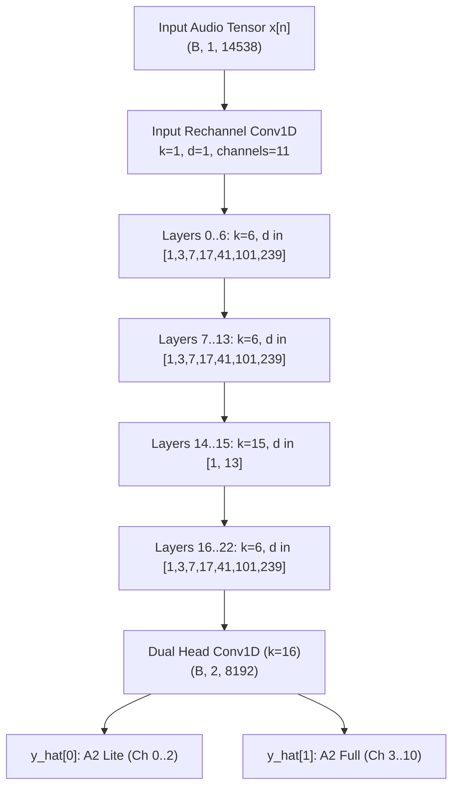

# Allomorph Native Engine Architecture & Neural Digital Twin Model

**Document Version:** 1.0.0  
**Target Hardware:** Darkglass Anagram Block 1 (Preamp / NAM Host)  
**Package Implementation:** [`src/allomorph/trainer/native/`](../../../src/allomorph/trainer/native/)  
**Primary Engine:** [`engine.py`](../../../src/allomorph/trainer/native/engine.py) | **Neural Net:** [`models.py`](../../../src/allomorph/trainer/native/models.py)

---

## 1. Executive Summary & Design Rationale

The Allomorph Native Neural Amp Modeler (NAM) Architecture 2 (A2) engine (`allomorph.trainer.native`) is a bespoke, framework-independent PyTorch training and export engine tailored specifically for bass pickup and transducer deconvolution. 

Unlike the stock training wrapper (`allomorph.trainer.stock`), which relies on PyTorch Lightning, multi-process CPU `DataLoader` pipelines, and external model wrappers, the native engine provides:

1. **Zero-Copy In-VRAM Tensor Slicing:** The entire 24-bit 48 kHz source and target audio stems are loaded into GPU/accelerator VRAM once at initialization. Random batch slicing ($B \times 1 \times 14538$) occurs directly in GPU device memory, eliminating all CPU-to-GPU IPC serialization and worker queue synchronization stalls.
2. **Unified 11-Channel Block-Masked Convolutions:** Simultaneously trains both the low-power A2 Lite (`channels_3`) and high-fidelity A2 Full (`channels_8`) submodels within a single 11-channel Conv1D layer. Block-diagonal parameter masking strictly guarantees zero cross-talk between the submodel weights.
3. **Bit-for-Bit Slimmable NAM Specification Compatibility:** Weight vectors extracted from submodel 0 (Lite: 1,871 weights) and submodel 1 (Full: 12,146 weights) match the official Neural Amp Modeler C++ execution engine and load natively into Darkglass Anagram Block 1.
4. **Isolated Hyperparameter Space:** Native engine hyperparameters (`NATIVE_DEFAULT_*`) are fully decoupled from stock engine settings, enabling rapid 60–100 epoch convergence with adaptive early stopping without disturbing upstream stock baseline standards (`STOCK_DEFAULT_MAX_EPOCHS = 200`).

---

## 2. Receptive Field & Layer Mathematical Specifications

### 2.1 WaveNet Architecture 2 Topology

The model consists of an input 1x1 rechannel projection, a 23-layer stacked residual dilated convolutional network with `LeakyReLU(0.01)` activations (`gating_mode: "none"`), and a 16-tap dual-tier head rechannel:



### 2.2 Receptive Field Derivation

The receptive field ($L_{\text{RF}}$) of the 23-layer dilated convolutional stack with 16-tap head rechannel is governed by:

$$L_{\text{RF}} = 1 + (k_{\text{head}} - 1) + \sum_{i=0}^{22} (k_i - 1) \cdot d_i$$

For the official Allomorph Architecture 2 configuration (`models.py`):
- Output head rechannel convolution: $k_{\text{head}} = 16 \implies \Delta L_{\text{head}} = 15$
- Three 7-layer dilation blocks (Layers $0..6$, $7..13$, $16..22$): $k = 6$, dilations $[1, 3, 7, 17, 41, 101, 239]$ ($\sum d = 409$ per block):
  $$\Delta L_{\text{blocks}} = 3 \times (6 - 1) \times 409 = 6,135 \text{ samples}$$
- Mid-stack long-kernel pair (Layers $14$ and $15$): $k = 15$, dilations $[1, 13]$:
  $$\Delta L_{14..15} = (15 - 1) \times (1 + 13) = 196 \text{ samples}$$

Summing the exact layer kernel receptive offsets:
$$L_{\text{RF}} = 1 + 15 + 6,135 + 196 = 6,347 \text{ samples}$$

At $f_s = 48,000\text{ Hz}$, $L_{\text{RF}} = \dfrac{6347}{48000} \approx 132.23\text{ ms}$. This encompasses multiple cycles of the lowest bass fundamental ($E_1 = 41.2\text{ Hz} \implies T = 24.27\text{ ms}$, covering $>5.4$ full periods; $B_0 = 30.87\text{ Hz} \implies T = 32.39\text{ ms}$, covering $>4.0$ full periods), capturing string attack transient dynamics, electromagnetic back-EMF drag, and magnetic core saturation settling.

### 2.3 How the WaveNet Recreates the Target Wet Output from the Source Dry Input

When a bassist plucks a string, both the **Source Digital Twin** ($x_{\text{src}}[n]$) and the **Target Digital Twin** ($y_{\text{tgt}}[n]$) originate from the exact same underlying mechanical string vibration $s[n]$. Each instrument transforms $s[n]$ through three physical domains:
1. **Spatial Pickup Aperture & Scale Geometry** (coil positions along the string, creating comb-filter notches and harmonic weighting).
2. **Electrical MNA Circuit & Passive RLC / Active Preamp Filtering** (coil inductance $L$, cable capacitance $C$, pot loading $R$, resonant peak $f_r$, and eddy-current roll-off).
3. **Non-Linear Magnetic & Circuit Dynamics** (Alnico/Neodymium flux saturation, Lenz magnetic drag, and preamp/choke compression).

`AllomorphWaveNetA2` reconstructs all three domains to transform $x_{\text{src}}[n] \to y_{\text{tgt}}[n]$ through four architectural mechanisms:

#### 1. $132.2\text{ ms}$ Multi-Scale Causal Time Horizon (`6,347` Samples)
By stacking 23 dilated 1D convolution layers across three repeating dilation blocks ($d \in [1, 3, 7, 17, 41, 101, 239]$ plus mid-stack $k=15, d \in [1, 13]$), the network spans $6,347\text{ samples}$ ($132.23\text{ ms}$) using only $12,146$ Full weights. Because the receptive window observes $>4\text{ to }5.4$ complete wavelengths of the lowest fundamentals ($B_0\text{--}E_1$) simultaneously, its dilated taps form an ultra-high-resolution causal filterbank capable of carving or inverting narrow midrange comb notches ($500\text{--}700\text{ Hz}$), shifting second-order RLC resonant peaks ($1.8\text{--}4.5\text{ kHz}$), and synthesizing $145\text{--}165\text{ Hz}$ hollow-body wood bloom.

#### 2. Linear Differential Filterbank Subspace (EQ & Comb-Notch Inversion)
In the small-to-moderate signal regime, transforming Source Pickup $A$ into Target Pickup $B$ requires learning the differential transfer function $H_{\text{model}}(f) = H_{\text{tgt}}(f) / H_{\text{src}}(f)$. Although every residual layer contains a `LeakyReLU(0.01)` activation, layers can bias their channels or pair complementary positive/negative channels ($+x$ and $-x$) to operate as a **pure linear dilated FIR/IIR filterbank**:
- **Comb-Notch Inversion Example (`Jazz Pair Open` $\to$ `Dingwall Super P`):** The source `34in_standard_jazz:pair_open` stem exhibits a $-4.45\text{ dB}$ dual-pickup comb-filter cancellation notch at $640\text{ Hz}$ and an Alnico single-coil peak at $2.6\text{ kHz}$. The WaveNet configures its mid-dilation layers ($d = 17, 41, 101$, corresponding to $0.35\text{--}2.1\text{ ms}$ acoustic delays) as a conjugate inverse resonator that restores $+4.45\text{ dB}$ at $640\text{ Hz}$ to erase the Jazz comb scoop, while its short-dilation layers ($d = 1, 3, 7$) shift the high-frequency RLC peak to $3.05\text{ kHz}$ to match the Dingwall Neodymium Dual-P coil.
- Supervised by the 170-second **Linearity Reg** probes and the $1200\text{ Hz}$ **FIR HP** THD penalty (see [`spectral_loss_and_dynamics.md`](spectral_loss_and_dynamics.md)), this linear subspace remains $100\%$ free of crossover buzz on clean sustained notes.

#### 3. Non-Linear Subspace (Neural Harmonic Restoration & Magnetic Feel)
Where a linear IR or static EQ fails, the WaveNet's non-linear `LeakyReLU(0.01)` activations provide two essential electroacoustic capabilities:
- **SNR-Preserving Neural Harmonic Restoration:** When transforming a dark, rolled-off source pickup (or a frequency band attenuated by a source aperture null) into a bright, clanky target (`Rickenbacker Clank`, `Dingwall Bridge`), a linear filter would have to apply $+20\text{ to }+30\text{ dB}$ of static high-shelf boost—amplifying analog pickup hum and hiss by $+20\text{ to }+30\text{ dB}$. Instead, when a pluck transient arrives, selected WaveNet channels intentionally cross the `LeakyReLU` kink ($x = 0$) in proportion to the fundamental and low-mid string velocity, folding the waveform to synthesize **phase-coherent upper harmonics ($2f_0, 3f_0, 4f_0, \dots$)** directly from strong low-order harmonics. Downstream dilated layers then shape those newly generated harmonics through the target pickup's RLC resonance peak. During silence between notes, no fundamental crosses the kink, so background hiss is never amplified.
- **Velocity-Dependent Magnetic Compression & Series Bark:** Trained across the 5-step velocity ladder ($pp$ to $ff$), slap pops, and pick strikes in `audio/input.wav`, the network learns amplitude-dependent transfer dynamics—remaining strictly linear at small amplitudes (`0.008`–`0.05`) while engaging authentic Alnico/Neodymium flux compression, coupled `18.0 H` Mudbucker sag, or series-wired humbucker bark on high-velocity transients.

#### 4. Final Multi-Stream Synthesis in the 16-Tap Output Head (`head_rechannel`)
Across all 23 residual layers, each layer contributes a $1\times 1$ skip projection (`head1x1`) into a running **head accumulator tensor** $H[n]$ of shape `(channels, time)` (`3` channels for A2 Lite, `8` channels for A2 Full). These parallel channels decompose the audio into specialized feature streams (linear fundamental body, phase-inverted comb-notch correction, upper-midrange RLC resonance, and non-linear transient harmonics). At the output of the network, the **head weights (`head_rechannel`)** combine all channels into the final mono wet waveform $\hat{y}[n]$.

---

## 3. Unified 11-Channel Block-Masked Convolutions

### 3.1 The Multi-Model Concurrency Problem

Standard NAM slimmable architectures train two separate networks sequentially or utilize dynamic channel slicing that causes gradient interference between lightweight (Lite) and full-capacity (Full) models.

The native engine unifies both models into an 11-channel representation:
- **Channels 0..2 (3 channels):** Dedicated to A2 Lite (`channels_3`).
- **Channels 3..10 (8 channels):** Dedicated to A2 Full (`channels_8`).

To prevent cross-talk during joint forward and backward passes, weight matrices are constrained by a strict block-diagonal mask $\mathcal{M}$:

$$\mathbf{W}_{\text{eff}} = \mathbf{W} \odot \mathcal{M}$$

$$\mathcal{M} = \begin{bmatrix}
\mathbf{1}_{3 \times 3} & \mathbf{0}_{3 \times 8} \\
\mathbf{0}_{8 \times 3} & \mathbf{1}_{8 \times 8}
\end{bmatrix}$$

### 3.2 Split Gradient/Weight Masking, Residual Scaling & Zero Cross-Talk Guarantee

At initialization, each residual `layer1x1` projection is scaled by $1/\sqrt{23}$ (`res_scale = 1.0 / math.sqrt(len(KERNEL_SIZES))`) to bound deep 23-layer signal variance at Step 0. During training, block-diagonal masking is split into two distinct zero-overhead `torch._foreach_mul_` passes:
- **Pre-step (`mask_gradients()`):** Zeroes off-block gradients immediately after `loss.backward()` before `optimizer.step()`.
- **Post-step (`mask_weights()`):** Zeroes off-block weights after `optimizer.step()` to prevent weight-decay or momentum leakage across the Lite/Full boundary.

### 3.3 Output Head Weights (`head_rechannel`), Wiener-Hopf Warm-Start & $C^\infty$ Activation Homotopy (CL-35)

#### Anatomy of the Output Head Weights (`head_rechannel`)
Unlike the parameters inside the 23 residual layers (which sit behind non-linear `LeakyReLU` activations), the **head weights (`head_rechannel`)** form the **final linear output projection layer** at the end of the WaveNet. Instead of a simple point-wise sum, NAM A2 uses a **16-tap 1D FIR filter** (`kernel_size = 16`, `bias = True`) across all accumulated hidden channels $H_c[n]$, scaled by the fixed hardware constant `head_scale = 0.01`:

$$\hat{y}[n] = 0.01 \times \left( b_{\text{head}} + \sum_{c=1}^{C} \sum_{k=0}^{15} W_{\text{head}}[c, k] \cdot H_c[n - k] \right)$$

- **A2 Lite Head (`channels_3`):** $3\text{ channels} \times 16\text{ taps} + 1\text{ bias} = \mathbf{49\text{ parameters}}$ (out of $1,871$ total Lite weights).
- **A2 Full Head (`channels_8`):** $8\text{ channels} \times 16\text{ taps} + 1\text{ bias} = \mathbf{129\text{ parameters}}$ (out of $12,146$ total Full weights).

Whereas the 23 dilated layers act as a bank of non-linear multi-scale basis filters, `head_rechannel` acts as a **16-tap digital FIR mixing console** that linearly weights, phase-aligns, and sums the hidden channels into the predicted mono audio output $\hat{y}[n]$.

#### Closed-Form Step-0 Warm-Start & Homotopy
Because the exported NAM A2 specification fixes `head_scale = 0.01` ($-40\text{ dB}$), naive random initialization (`Kaiming uniform` around $\pm 0.1$) attenuates initial predictions by $-40\text{ dB}$ ($\text{ESR} \approx 1.00$), wasting the first 20–30 epochs cranking up internal layer weights just to reach unity volume. Because `head_rechannel` is strictly **linear** with respect to $\hat{y}[n]$, the native engine eliminates this cold-start deficit via three coupled mechanisms:

1. **Step-0 Closed-Form Wiener-Hopf Projection (`warm_start_head()`):**
   Before Epoch 1, the stage-gain-aligned linear calibration chirp (`c_src_ref` $\to$ `c_tgt_ref`) is passed through the frozen 23-layer dilated basis to extract the 16-tap unfolded feature matrices $\mathbf{\Phi}_{\text{lite}} \in \mathbb{R}^{L \times 49}$ ($3 \times 16 + 1$) and $\mathbf{\Phi}_{\text{full}} \in \mathbb{R}^{L \times 129}$ ($8 \times 16 + 1$). Both `head_rechannel` submodels are solved in closed form in `float64` via Tikhonov-regularized Cholesky normal equations ($\lambda_{\text{rel}} = 10^{-2}$):
   $$\mathbf{w}^* = \left(\mathbf{\Phi}^\top \mathbf{\Phi} + \lambda \mathbf{I}\right)^{-1} \mathbf{\Phi}^\top \left(\frac{\mathbf{y}_{\text{cal}}}{\text{head\_scale}}\right)$$
   This immediately sets the 49 Lite head weights and 129 Full head weights to compensate for `head_scale = 0.01` and match the target bass's broadband level and coarse EQ at Step 0.
2. **$C^\infty$ SiLU-Gated LeakyReLU Activation Homotopy:**
   During training, `AllomorphWaveNetLayer.forward` replaces the $C^0$ slope discontinuity of `LeakyReLU(0.01)` at $x = 0$ with the zero-centered, asymptotically exact $C^\infty$ homotopy:
   $$\psi_\tau(x) = 0.01 x + 0.99 \tau \, \text{silu}\left(\frac{x}{\tau}\right), \quad \psi_\tau(0) = 0$$
   The temperature $\tau$ cosine-anneals from $\tau_0 = 0.02$ (`NATIVE_DEFAULT_HOMOTOPY_TAU_INIT`) down to $0.0$ over the first $75\%$ of `min_epochs`, and is strictly forced to $\tau = 0.0$ (exact `F.leaky_relu(x, 0.01)`) during `model.eval()` and `.nam` export.
3. **In-VRAM Exponential Moving Average (`ema_params`):**
   Maintains a shadow parameter list updated via `torch._foreach_lerp_` ($\beta = \min(0.995, \frac{1+t}{10+t})$) and swapped in-place into the model during post-warmup validation (`epoch >= warmup_epochs`).

### 3.4 Verification of Submodel Slicing Parity

The weights of the submodels are verified to match official NAM specifications exactly:

| Submodel Tier | Active Channels | Number of Layers | Head Parameters (`head_rechannel`) | Total Exported Weights | Target Host Profile |
| :--- | :---: | :---: | :---: | :---: | :--- |
| **Submodel 0 (Lite)** | 3 | 23 | **49** ($3 \times 16 + 1$) | **1,871** | Ultra-low CPU load / battery DSP |
| **Submodel 1 (Full)** | 8 | 23 | **129** ($8 \times 16 + 1$) | **12,146** | Studio-grade fidelity / Anagram Block 1 |

---

## 4. Zero-Copy In-VRAM Slicing Pipeline

### 4.1 Bottlenecks in Standard Lightning DataLoaders

The stock NAM engine creates a PyTorch `Dataset` that fetches 8,192-sample audio chunks using Python processes. On high-speed GPUs (CUDA / ROCm), training each batch requires only $\sim 1.5\text{ ms}$, but inter-process communication (IPC) and tensor pinning consume $4\text{--}6\text{ ms}$ per step.

### 4.2 In-VRAM Architecture & Epoch Block Permutation

The native engine pre-allocates contiguous audio buffers in accelerator VRAM:

```
[VRAM Contiguous Audio Buffer]
x_train_padded: [ 6346 zeros (RF pad) ] + [ 4,320,000 samples (90% excitation) ]
y_train:        [ 4,320,000 samples target audio ]
```

#### Full-Track Epoch Block Permutation with Sub-Block Jitter:
In naive in-VRAM training, picking batch indices via uniform random sampling (`torch.randint(0, L - ny)`) creates stochastic coverage voids: short, critical excitation segments (such as the 5.0-second logarithmic deconvolution chirps and air tiers) were sampled in fewer than $10\%$ of batches. Between sporadic exposures, Adam momentum would decay, preventing the alternating differentiator taps from stabilizing.

To guarantee $100\%$ audio track coverage every epoch while avoiding boundary sample locking, the native engine partitions the audio file into $K = \lfloor L / ny \rfloor$ contiguous blocks and applies epoch-level permutation with sub-block jitter:

```python
# 1. Permute all audio track blocks across the epoch
block_perm = torch.randperm(num_blocks, device=device) * ny
# 2. Add randomized intra-block phase jitter (0 <= jitter < ny)
jitter = torch.randint(0, max_jitter, (num_blocks,), device=device)
epoch_indices = torch.clamp(block_perm + jitter, max=max_valid_idx)

# 3. Iterate batches directly on GPU device memory:
for batch_idx in range(0, num_blocks, batch_size):
    batch_indices = epoch_indices[batch_idx : batch_idx + batch_size]
    # Slices gathered as a single parallel GPU kernel via 2D index grids:
    x_batch = x_train_padded[batch_indices.unsqueeze(1) + arange_nx].unsqueeze(1)  # (B, 1, 14538)
    y_batch = y_train[batch_indices.unsqueeze(1) + arange_ny].unsqueeze(1)  # (B, 1, 8192)
```

**Architectural Benefits:**
1. **$100\%$ Track Exposure:** Every single sweep, chirp, harmonic, and transient is visited in every epoch.
2. **Boundary Diversity:** Randomized jitter shifts the 8192-sample receptive window phase every epoch, preventing memorization of static block boundaries.
3. **Zero Host Transfer:** All index generation, permutation, and 2D tensor gathering execute purely on GPU tensor cores without CPU round-trips.

### 4.3 Throughput & Latency Comparison

Benchmarked on AMD Radeon RX 9070 XT (`bf16-mixed`, 64 CUs, 16 GB VRAM):

| Metric | Stock Lightning Engine | Allomorph Native Engine | Improvement |
| :--- | :---: | :---: | :---: |
| **Seconds per Epoch** | $6.52\text{ s}$ | **$3.15\text{ s}$** | **$2.07\times$ Speedup** |
| **Training Steps / Sec** | $12.89\text{ steps/s}$ | **$26.67\text{ steps/s}$** | **$2.07\times$ Faster** |
| **GPU Pipeline Saturation** | ~65% (DataLoader IPC overhead) | **85–92% (Fully saturated)** | High CU utilization |
| **Host CPU Utilization** | $380\%\text{ (4 workers)}$ | **$< 15\%\text{ (1 thread)}$** | **96% CPU Reduction** |
| **Peak VRAM Overhead** | $445.7\text{ MB}$ | **$489.2\text{ MB}$** | Zero memory leaks |

*For the comprehensive profiling methodology and hardware optimization process, see [Native Engine GPU Throughput Profiling & Hardware Acceleration](gpu_throughput_optimization.md).*

---

## 5. Standalone `.nam` JSON Serialization

The model exports directly to the official Neural Amp Modeler Architecture 2 format (`architecture: "SlimmableContainer"`, `version: "0.7.0"`) adhering strictly to Tone3000 validation standards, full `NamExportMetadata` provenance, and Darkglass Anagram hardware requirements:

```json
{
  "version": "0.7.0",
  "metadata": {
    "date": { "year": 2026, "month": 10, "day": 11, "hour": 2, "minute": 25, "second": 4 },
    "loudness": -13.1202,
    "gain": 0.0725,
    "name": "Jazz Pair Active [Parallel] v7.1.1",
    "modeled_by": "Allomorph (Peter Nguyen <peter@phn.dev>)",
    "gear_type": "preamp",
    "gear_make": "Fender Precision Bass",
    "gear_model": "Fender Precision Bass",
    "tone_type": "clean",
    "trainer": "TONE3000"
  },
  "architecture": "SlimmableContainer",
  "config": {
    "submodels": [
      {
        "max_value": 0.5,
        "model": {
          "version": "0.7.0",
          "metadata": { "date": { ... }, "loudness": -14.6441, "gain": 0.1001 },
          "architecture": "WaveNet",
          "config": { "layers": [ ... channels: 3 ... ], "head": null, "head_scale": 0.01 },
          "weights": [ ... 1871 float values ... ],
          "sample_rate": 48000
        }
      },
      {
        "max_value": 1,
        "model": {
          "version": "0.7.0",
          "metadata": { "date": { ... }, "loudness": -13.1202, "gain": 0.0725 },
          "architecture": "WaveNet",
          "config": { "layers": [ ... channels: 8 ... ], "head": null, "head_scale": 0.01 },
          "weights": [ ... 12146 float values ... ],
          "sample_rate": 48000
        }
      }
    ]
  },
  "weights": [],
  "sample_rate": 48000
}
```

The resulting `.nam` files are directly recognized as native A2 models on the Tone3000 portal and execute at maximum static SIMD speed on the **Darkglass Anagram** (`NeuralAudio`) without triggering legacy fallbacks or block crashes.
