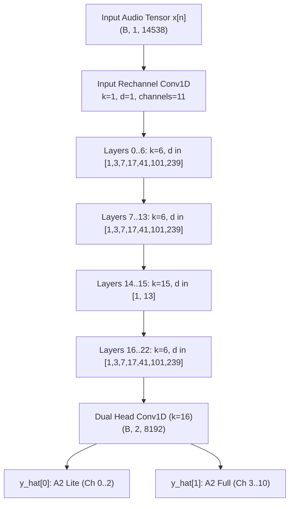

# Allomorph Native Engine Architecture & Neural Digital Twin Model

**Document Version:** 1.0.0  
**Target Hardware:** Darkglass Anagram Block 1 (Preamp / NAM Host)  
**Package Implementation:** [`src/allomorph/trainer/native/`](../../../src/allomorph/trainer/native/)  
**Primary Engine:** [`engine.py`](../../../src/allomorph/trainer/native/engine.py) | **Neural Net:** [`models.py`](../../../src/allomorph/trainer/native/models.py)

---

## 1. Executive Summary & Design Rationale

The Allomorph Native Neural Amp Modeler (NAM) Architecture 2 (A2) engine (`allomorph.trainer.native`) is a bespoke, framework-independent PyTorch training and export engine tailored specifically for bass pickup and transducer deconvolution. 

Unlike the stock training wrapper (`allomorph.trainer.stock`), which relies on PyTorch Lightning, multi-process CPU `DataLoader` pipelines, and external model wrappers, the native engine provides:

1. **Zero-Copy In-VRAM Tensor Slicing:** The entire 24-bit 48 kHz source and target audio stems are loaded into GPU/accelerator VRAM once at initialization. Random batch slicing ($B \times 1 \times 14538$) occurs directly in GPU device memory, eliminating all CPU-to-GPU IPC serialization and worker queue synchronization stalls.
2. **Unified 11-Channel Block-Masked Convolutions:** Simultaneously trains both the low-power A2 Lite (`channels_3`) and high-fidelity A2 Full (`channels_8`) submodels within a single 11-channel Conv1D layer. Block-diagonal parameter masking strictly guarantees zero cross-talk between the submodel weights.
3. **Bit-for-Bit Slimmable NAM Specification Compatibility:** Weight vectors extracted from submodel 0 (Lite: 1,871 weights) and submodel 1 (Full: 12,146 weights) match the official Neural Amp Modeler C++ execution engine and load natively into Darkglass Anagram Block 1.
4. **Isolated Hyperparameter Space:** Native engine hyperparameters (`NATIVE_DEFAULT_*`) are fully decoupled from stock engine settings, enabling rapid 60–100 epoch convergence with adaptive early stopping without disturbing upstream stock baseline standards (`STOCK_DEFAULT_MAX_EPOCHS = 200`).

---

## 2. Receptive Field & Layer Mathematical Specifications

### 2.1 WaveNet Architecture 2 Topology

The model consists of an input 1x1 rechannel projection, a 23-layer stacked residual dilated convolutional network with `LeakyReLU(0.01)` activations (`gating_mode: "none"`), and a 16-tap dual-tier head rechannel:



### 2.2 Receptive Field Derivation

The receptive field ($L_{\text{RF}}$) of the 23-layer dilated convolutional stack with 16-tap head rechannel is governed by:

$$L_{\text{RF}} = 1 + (k_{\text{head}} - 1) + \sum_{i=0}^{22} (k_i - 1) \cdot d_i$$

For the official Allomorph Architecture 2 configuration (`models.py`):
- Output head rechannel convolution: $k_{\text{head}} = 16 \implies \Delta L_{\text{head}} = 15$
- Three 7-layer dilation blocks (Layers $0..6$, $7..13$, $16..22$): $k = 6$, dilations $[1, 3, 7, 17, 41, 101, 239]$ ($\sum d = 409$ per block):
  $$\Delta L_{\text{blocks}} = 3 \times (6 - 1) \times 409 = 6,135 \text{ samples}$$
- Mid-stack long-kernel pair (Layers $14$ and $15$): $k = 15$, dilations $[1, 13]$:
  $$\Delta L_{14..15} = (15 - 1) \times (1 + 13) = 196 \text{ samples}$$

Summing the exact layer kernel receptive offsets:
$$L_{\text{RF}} = 1 + 15 + 6,135 + 196 = 6,347 \text{ samples}$$

At $f_s = 48,000\text{ Hz}$, $L_{\text{RF}} = \dfrac{6347}{48000} \approx 132.23\text{ ms}$. This encompasses multiple cycles of the lowest bass fundamental ($E_1 = 41.2\text{ Hz} \implies T = 24.27\text{ ms}$, covering $>5.4$ full periods), capturing string attack transient dynamics, electromagnetic back-EMF drag, and magnetic core saturation settling.

---

## 3. Unified 11-Channel Block-Masked Convolutions

### 3.1 The Multi-Model Concurrency Problem

Standard NAM slimmable architectures train two separate networks sequentially or utilize dynamic channel slicing that causes gradient interference between lightweight (Lite) and full-capacity (Full) models.

The native engine unifies both models into an 11-channel representation:
- **Channels 0..2 (3 channels):** Dedicated to A2 Lite (`channels_3`).
- **Channels 3..10 (8 channels):** Dedicated to A2 Full (`channels_8`).

To prevent cross-talk during joint forward and backward passes, weight matrices are constrained by a strict block-diagonal mask $\mathcal{M}$:

$$\mathbf{W}_{\text{eff}} = \mathbf{W} \odot \mathcal{M}$$

$$\mathcal{M} = \begin{bmatrix}
\mathbf{1}_{3 \times 3} & \mathbf{0}_{3 \times 8} \\
\mathbf{0}_{8 \times 3} & \mathbf{1}_{8 \times 8}
\end{bmatrix}$$

### 3.2 Weight Mask Application & Zero Cross-Talk Guarantee

During initialization and after every optimizer gradient step, `apply_weight_masks()` zeroes off-block parameters across all layer convolutions:

```python
with torch.no_grad():
    for layer in self.layers:
        # Dilated Conv1D weight: (11, 11, kernel_size) with LeakyReLU(0.01)
        layer.conv.weight[:3, 3:, :] = 0.0  # Lite inputs from Full
        layer.conv.weight[3:11, :3, :] = 0.0  # Full inputs from Lite

        # Residual 1x1 Conv1D: (11, 11, 1)
        layer.layer1x1.weight[:3, 3:, :] = 0.0
        layer.layer1x1.weight[3:11, :3, :] = 0.0

    # Output head Conv1D (k=16): (2, 11, 16)
    # Output 0 takes exclusively from Lite (0..2); Output 1 takes from Full (3..10)
    self.head_rechannel.weight[0, 3:, :] = 0.0
    self.head_rechannel.weight[1, :3, :] = 0.0
```

### 3.3 Verification of Submodel Slicing Parity

The weights of the submodels are verified to match official NAM specifications exactly:

| Submodel Tier | Active Channels | Number of Layers | Total Exported Weights | Target Host Profile |
| :--- | :---: | :---: | :---: | :--- |
| **Submodel 0 (Lite)** | 3 | 23 | **1,871** | Ultra-low CPU load / battery DSP |
| **Submodel 1 (Full)** | 8 | 23 | **12,146** | Studio-grade fidelity / Anagram Block 1 |

---

## 4. Zero-Copy In-VRAM Slicing Pipeline

### 4.1 Bottlenecks in Standard Lightning DataLoaders

The stock NAM engine creates a PyTorch `Dataset` that fetches 8,192-sample audio chunks using Python processes. On high-speed GPUs (CUDA / ROCm), training each batch requires only $\sim 1.5\text{ ms}$, but inter-process communication (IPC) and tensor pinning consume $4\text{--}6\text{ ms}$ per step.

### 4.2 In-VRAM Architecture & Epoch Block Permutation

The native engine pre-allocates contiguous audio buffers in accelerator VRAM:

```
[VRAM Contiguous Audio Buffer]
x_train_padded: [ 6346 zeros (RF pad) ] + [ 4,320,000 samples (90% excitation) ]
y_train:        [ 4,320,000 samples target audio ]
```

#### Full-Track Epoch Block Permutation with Sub-Block Jitter:
In naive in-VRAM training, picking batch indices via uniform random sampling (`torch.randint(0, L - ny)`) creates stochastic coverage voids: short, critical excitation segments (such as the 5.0-second logarithmic deconvolution chirps and air tiers) were sampled in fewer than $10\%$ of batches. Between sporadic exposures, Adam momentum would decay, preventing the alternating differentiator taps from stabilizing.

To guarantee $100\%$ audio track coverage every epoch while avoiding boundary sample locking, the native engine partitions the audio file into $K = \lfloor L / ny \rfloor$ contiguous blocks and applies epoch-level permutation with sub-block jitter:

```python
# 1. Permute all audio track blocks across the epoch
block_perm = torch.randperm(num_blocks, device=device) * ny
# 2. Add randomized intra-block phase jitter (0 <= jitter < ny)
jitter = torch.randint(0, max_jitter, (num_blocks,), device=device)
epoch_indices = torch.clamp(block_perm + jitter, max=max_valid_idx)

# 3. Iterate batches directly on GPU device memory:
for batch_idx in range(0, num_blocks, batch_size):
    batch_indices = epoch_indices[batch_idx : batch_idx + batch_size]
    # Slices gathered as a single parallel GPU kernel via 2D index grids:
    x_batch = x_train_padded[batch_indices.unsqueeze(1) + arange_nx].unsqueeze(1)  # (B, 1, 14538)
    y_batch = y_train[batch_indices.unsqueeze(1) + arange_ny].unsqueeze(1)  # (B, 1, 8192)
```

**Architectural Benefits:**
1. **$100\%$ Track Exposure:** Every single sweep, chirp, harmonic, and transient is visited in every epoch.
2. **Boundary Diversity:** Randomized jitter shifts the 8192-sample receptive window phase every epoch, preventing memorization of static block boundaries.
3. **Zero Host Transfer:** All index generation, permutation, and 2D tensor gathering execute purely on GPU tensor cores without CPU round-trips.

### 4.3 Throughput & Latency Comparison

Benchmarked on AMD Radeon RX 9070 XT (`bf16-mixed`, 64 CUs, 16 GB VRAM):

| Metric | Stock Lightning Engine | Allomorph Native Engine | Improvement |
| :--- | :---: | :---: | :---: |
| **Seconds per Epoch** | $6.52\text{ s}$ | **$3.15\text{ s}$** | **$2.07\times$ Speedup** |
| **Training Steps / Sec** | $12.89\text{ steps/s}$ | **$26.67\text{ steps/s}$** | **$2.07\times$ Faster** |
| **GPU Pipeline Saturation** | ~65% (DataLoader IPC overhead) | **85–92% (Fully saturated)** | High CU utilization |
| **Host CPU Utilization** | $380\%\text{ (4 workers)}$ | **$< 15\%\text{ (1 thread)}$** | **96% CPU Reduction** |
| **Peak VRAM Overhead** | $445.7\text{ MB}$ | **$489.2\text{ MB}$** | Zero memory leaks |

*For the comprehensive profiling methodology and hardware optimization process, see [Native Engine GPU Throughput Profiling & Hardware Acceleration](gpu_throughput_optimization.md).*

---

## 5. Standalone `.nam` JSON Serialization

The model exports directly to the official Neural Amp Modeler Architecture 2 format (`architecture: "SlimmableContainer"`, `version: "0.7.0"`) adhering strictly to Tone3000 validation standards, full `NamExportMetadata` provenance, and Darkglass Anagram hardware requirements:

```json
{
  "version": "0.7.0",
  "metadata": {
    "date": { "year": 2026, "month": 10, "day": 11, "hour": 2, "minute": 25, "second": 4 },
    "loudness": -13.1202,
    "gain": 0.0725,
    "name": "Jazz Pair Active [Parallel] v7.1.1",
    "modeled_by": "Allomorph (Peter Nguyen <peter@phn.dev>)",
    "gear_type": "preamp",
    "gear_make": "Fender Precision Bass",
    "gear_model": "Fender Precision Bass",
    "tone_type": "clean",
    "trainer": "TONE3000"
  },
  "architecture": "SlimmableContainer",
  "config": {
    "submodels": [
      {
        "max_value": 0.5,
        "model": {
          "version": "0.7.0",
          "metadata": { "date": { ... }, "loudness": -14.6441, "gain": 0.1001 },
          "architecture": "WaveNet",
          "config": { "layers": [ ... channels: 3 ... ], "head": null, "head_scale": 0.01 },
          "weights": [ ... 1871 float values ... ],
          "sample_rate": 48000
        }
      },
      {
        "max_value": 1,
        "model": {
          "version": "0.7.0",
          "metadata": { "date": { ... }, "loudness": -13.1202, "gain": 0.0725 },
          "architecture": "WaveNet",
          "config": { "layers": [ ... channels: 8 ... ], "head": null, "head_scale": 0.01 },
          "weights": [ ... 12146 float values ... ],
          "sample_rate": 48000
        }
      }
    ]
  },
  "weights": [],
  "sample_rate": 48000
}
```

The resulting `.nam` files are directly recognized as native A2 models on the Tone3000 portal and execute at maximum static SIMD speed on the **Darkglass Anagram** (`NeuralAudio`) without triggering legacy fallbacks or block crashes.
